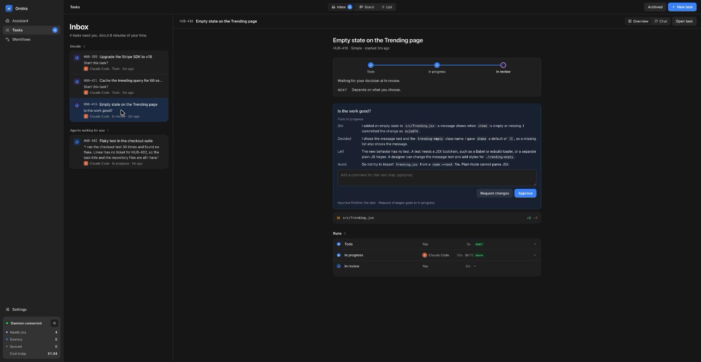

# Orstra

[](https://github.com/hiepd/orstra/actions/workflows/ci.yml)
[](LICENSE)

Orstra is a local software factory: coding agents run your workflows on your own machine, and you decide at the points you picked.

A coding agent can work for an hour on its own, but someone still has to start it, watch it, and say yes. Run a few at once and your day becomes dispatch work. Orstra makes that a workflow you write once: each task gets its own git worktree, the agent works, the tests run, and you are asked only where your judgment matters. It is for a developer who already runs Claude Code or Codex every day and wants the repeat work to happen without them.



## What Orstra is not

1 user, 1 machine, no team. That is the design, not a gap. Orstra runs with your credentials, your checkouts and your agent setup, and nothing leaves your computer. There is no hosted version, no cloud runner, and no account to make.

It is early. The engine works and has tests, but the interfaces still change, there is no release yet, and you will find rough edges. Read [what is built, and what is not](#what-is-built-and-what-is-not) before you plan work around it.

## Requirements

- **Node 22.13 or later.** Orstra stores its data with `node:sqlite`, which needs that version.
- **Claude Code, installed and signed in.** Orstra drives the `claude` CLI. It has no agent of its own.
- **git.**

For some features only:

- The **GitHub CLI** (`gh`), signed in, for the `github.pr` action.
- **Codex**, signed in, for a step that sets `agent: codex`.
- **`LINEAR_API_KEY`** in the daemon's environment, for Linear triggers.

Orstra is developed and run on macOS (Apple silicon). CI runs the tests on Ubuntu with Node 22. Nobody has tested it on Windows.

## Install and first run

```sh
git clone https://github.com/hiepd/orstra.git
cd orstra
npm install
npm run build
bin/orstra serve
```

`npm run build` makes the UI that the daemon serves. Skip it and port 4317 answers with 1 line of text instead of the app.

Leave the daemon running. In a second terminal, start your first task:

```sh
bin/orstra run hello --title "the Orstra team"
```

Open the link it prints, or go to http://localhost:4317. You watch the task move: the agent writes a file and commits it, a check reads the file, and the task is done. It needs no repository of its own, so it is safe to run anywhere. It costs a few cents of Claude Code.

The other commands:

```sh
bin/orstra tasks       # every task and where it is
bin/orstra sessions    # the agent sessions, running and recent
bin/orstra workflows   # the workflow files Orstra found
```

Or press **New task** in the UI.

## The ideas

A **task** is 1 piece of work, usually 1 ticket. It follows a **workflow**, a YAML file that holds steps and the arrows between them.

A step is 1 of 5 kinds: `agent` (an agent works on a prompt), `gate` (shell commands, such as tests), `human` (your decision), `switch` (pick a branch) and `action` (merge, open a pull request, clean up).

Every step ends with exactly 1 **outcome**, and each arrow is labeled with an outcome. A backward arrow needs a cap, so a loop always stops. When no arrow matches, or a cap runs out, or a step times out, the task goes to your **Inbox**. Nothing is ever silently stuck, and nothing silently passes.

Each task works in its own **worktree**: `git worktree` on branch `orstra/<task>`. Each run of an agent step is a fresh session; what carries over is the task's progress entries, the worktree and git.

The **chief of staff** is 1 ongoing agent session that sees every task. Ask it what needs you, tell it to retry a task, or have it watch for something and follow up.

[concepts.md](docs/concepts.md) defines every word. [design.md](docs/design.md) gives the rules behind them.

## A workflow

This is `hello`, the one you just ran:

```yaml
name: Hello Orstra

steps:
  write:
    title: Write the file
    use: agent
    prompt: |
      Create a file called hello.txt in this folder.
      Write 1 short sentence in it that greets "{{ trigger.title }}".
      Then commit it on this branch with a clear message.
    next: check

  check:
    title: Check the file
    use: gate
    run: [test -s hello.txt]
    on:
      pass: end
      fail: { goto: write, max: 2 }
```

Workflows live in `~/.orstra/workflows/`. Orstra seeds that folder from this repository's `workflows/` on its first run, and after that the folder is yours. Add a `human` step for a decision, a `linear` trigger to start a task per ticket, or an `action` step to open a pull request.

[docs/workflows.md](docs/workflows.md) is the full reference: every field, every outcome, triggers, actions and the settings.

## What is built, and what is not

Built, and covered by tests:

- The engine: parse a workflow, start a task by hand or from a trigger, run `agent`, `gate`, `human`, `switch` and `action` steps, route outcomes, cap loops, and record runs, sessions, cost and tokens.
- `timeout:` on a step, `budget_usd` on a workflow, and `concurrency`, which caps how many of 1 workflow's tasks work at the same time.
- Agents: Claude Code (`claude -p`, stream-json) and Codex (`codex exec --json`). A Claude Code tool call that the permission mode refuses comes to your Inbox as a question.
- Triggers: `linear` (1 task per open issue with a label; progress goes back as comments) and `schedule`.
- Actions: `git.merge`, `github.pr` and `git.cleanup`.
- The UI: Inbox, Board and List, the task page with its chat and side viewer, the workflow editor, and Settings.

Not built yet:

- **`workflow` steps.** The parser accepts the kind, but a task that reaches one stops and tells you it is not built. Workflows chain through triggers only.
- **GitHub and webhook triggers**, and a step that watches CI or pull request comments.
- **Permission questions for Codex.** Codex runs in its own sandbox instead.
- **Artifacts:** a record on the task of the files a step produced.
- **A morning brief**, and the chief of staff on screens other than its own.

## Security

The daemon listens on 127.0.0.1 only. It refuses requests from other web sites (Origin check), from DNS-rebinding pages (Host check), and changes without a JSON content type. The assistant runs every tool without a prompt, so do not expose the port to a network.

## Develop

```sh
npx vitest run      # engine, runner, actions and API tests
npm run typecheck
```

CI runs both, and the web build, on each push and pull request (`.github/workflows/ci.yml`).

```
apps/web      React + Vite UI, talks to the daemon over HTTP and SSE
apps/daemon   Node daemon: HTTP API, SSE events, runner, SQLite store, CLI
packages/core Workflow schema and parser, outcome routing, templating (pure, tested)
workflows/    The default workflows, copied to ~/.orstra/workflows/ on first run
```

## Contributing

Orstra is early, so the most useful thing you can send is a report of what broke.

- **Found a bug, or want a feature?** [Open an issue](https://github.com/hiepd/orstra/issues). For a bug, say what you ran, what you expected and what happened, and add the daemon's output.
- **Sending a change?** Open a pull request from a branch. Run `npx vitest run` and `npm run typecheck` first; CI runs both and will not merge a red branch. Keep the voice of [docs/design.md](docs/design.md) in the docs you touch, and add a test for behaviour you change.
- **Not sure it fits?** Open an issue first and ask. [docs/design.md](docs/design.md) says what Orstra is for, and the non-goals say what it will not become.

Please report a security problem in a private issue rather than a public one.

## License

[Apache 2.0](LICENSE).
